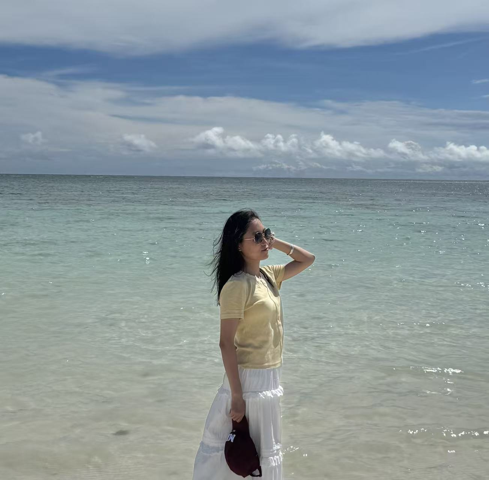
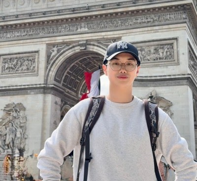

I am always on the lookout for excellent **PhD/Visiting students** to work with me on LLM reasoning, safety, interpretability, etc.
- Fully-funded positions for exceptional candidates through KCL scholarships. These funding allocations are for full fees and a living stipend (London weighted) for any nationality. [Scholarships and Studentships](https://www.kcl.ac.uk/study/postgraduate-research/funding/scholarships-and-studentships)
- [K-CSC](https://www.kcl.ac.uk/study-legacy/funding/kings-china-scholarship-council-phd-scholarship-programme-k-csc) (for Chinese nationals)
- [STAI-AI CDT](https://www.kcl.ac.uk/research/star-ai) 

I am also looking for **postdoc** working in AI interpretability, safety, applying through various fellowship/programs such as: 
Marie Curie Individual Fellowship,  CSC-funded Postdoc Programme etc. 

## PhD students

  

    
     
    <a href="https://yjeugenia.github.io/">Yujing Wang</a>
  

  

    
     
    <a href="https://scholar.google.com/citations?user=vZNU7wcAAAAJ&hl=zh-CN&inst=15159612047463182172">Jiangnan Ye</a>
     
    (1st supervisor: Yulan He)
  

  

    
     
    <a href="">Xiyuan Cao</a>
     
    (1st supervisor: Denise Hawkes)
  

## Co-authorship students at KCL-NLP Group
<ul class="student-list">
  <li><strong>LLM reasoning</strong>
    <ul>
      <li>Qinglin Zhu (Search&Plan) </li>
      <li>Zhanghao Hu (RAG)</li>
      <li>Zhenyi Shen (Self-distillation)</li>
    </ul>
  </li>
  <li><strong>Explainable AI</strong>
    <ul>
      <li>Jiazheng Li (faithful explanation)</li>
      <li>Hainiu Xu (mechanistic interpretability)</li>
    </ul>
  </li>
  <li><strong>AutoResearch</strong>
    <ul>
      <li>Yanzheng Xiang (code agent & idea evolution)</li>
      <li>Italo Da Silva (Novelty assessment & Information Retrieval)</li>
    </ul>
  </li>
</ul>

## Other mentorship
- Xinnong Zhang (Remote & Onsite, Fudan PhD)
- Ahmed Oumar (Remote, MBZUAI PhD)
- Yujing Wang (Remote, Buaa Msc, Now KCL PhD)
- Lakshmipriya Ragupathi (KCL MSc)
- Yu Tian (Visiting student from Beijing Jiaotong University)

## Master Thesis
- Five projects in retrieval-based QA (2025-2026)

